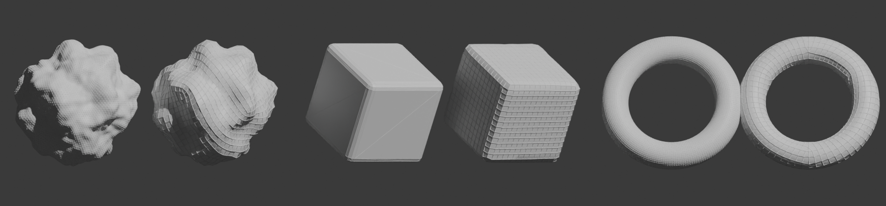
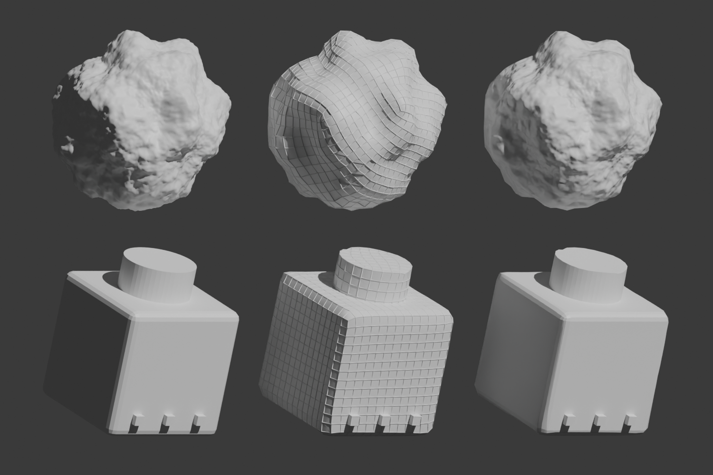

# Auto Retopology for Blender

One-click, highly configurable automatic retopology. Pick a method and a density, press
**Retopologize**, and get a clean quad mesh projected back onto your original. 114
settings let you tune each stage, from input cleanup to multires detail baking.

New in 1.1: **Game-Ready Rebuild**, which throws the original topology away and rebuilds the
same shape as a game asset, with a baked normal map, UVs and LODs.



*Left of each pair: original. Right: Auto Retopology result (QuadriFlow, default settings
+ target face count; the box uses **Preserve Sharp**, the torus uses **Symmetry X**).*

## Game-Ready Rebuild



*Left: original. Middle: rebuilt topology. Right: the rebuilt low poly rendered with its baked
normal map. Top: 81,920-triangle sculpt rebuilt to 2,350 triangles (0.22% average deviation).
Bottom: hard-surface kitbash (box, cylinder and rails as intersecting parts) rebuilt to 2,946
triangles with the* Game-Ready Hard Surface *settings.*

Choose **Game-Ready Rebuild** as the method (or a *Game-Ready* quick preset), set a
**Triangle Budget**, and press **Retopologize**. Nothing of the original edge flow is kept:

1. **Shape capture**: the original is converted into a watertight voxel shell at
   *Shape Detail* × the target resolution. This repairs holes, overlaps and broken geometry.
2. **Candidates**: several topologies are built and compared:
   - *Clean Quads*: QuadriFlow from the shell, one per seed (*Candidates*).
   - *Direct*: QuadriFlow on the exact original surface, used only when the original is
     closed and manifold, including several closed parts that intersect. This keeps sharp
     edges crisp and separate parts separate.
   - *Adaptive*: curvature-adaptive QEM reduction, joined into quads. It is dense where the
     shape needs detail and sparse where it is flat, which gives the best silhouette per
     triangle for static props.
3. **Scoring**: each candidate is relaxed onto the surface and scored on shape deviation and
   topology quality. Deviation is measured both ways, so lost silhouette counts as well as
   faces that cut corners. Topology quality counts poles, valence-2/6+ vertices, fold-overs,
   quad ratio and n-gons. *Pick By* (Shape / Balanced / Topology) sets the balance, and the
   best-scoring candidate wins.
4. **Game mesh rules**: the result has no n-gons, no stray valence-2 vertices and no loose
   geometry, and its normals are consistent. Hard edges are set by angle and get UV seams
   (needed for clean normal-map bakes). Shading can be *smooth + hard edges*,
   *weighted normals* (hard surface) or *fully smooth* (organic). Triangulation is optional
   and locks the bake.
5. **UVs**: Smart UV Project split at hard edges, then uniform texel density, then packing
   with pixel padding for the chosen texture size.
6. **Baking**: a tangent-space normal map (and optionally AO) is baked from the original with
   Cycles. The cage size comes from the measured deviation. The maps are packed into the
   .blend or saved as PNGs, and wired into a new PBR material.
7. **LODs, origin and report**: LOD1…LODn are generated (placed side by side if you like).
   The origin can move to the bottom/center and the rotation can be applied. A quality report
   (triangles vs budget, average/max deviation as a percentage of the object's size, winning
   candidate, baked maps, LOD triangle counts) appears under **Tools & Analysis**.

Re-running the selected result replaces it together with its LODs, material and baked
images, so nothing piles up.

## Features

- **5 methods**: QuadriFlow quad remesh, Voxel remesh, Decimate (Collapse / Un-Subdivide /
  Planar), Octree remesh (Blocks / Smooth / Sharp) and **Game-Ready Rebuild**.
- **Unified density control**: target face count, ratio of the input, or edge length in world
  units, applied the same way by every method.
- **Robust input handling**: a voxel cleanup pass makes any mesh manifold for QuadriFlow, heavy
  meshes are pre-decimated, size is normalized so tiny real-world objects work, and failed runs
  retry with a new seed.
- **Pre-processing**: merge by distance, delete loose geometry, remove small floating parts,
  fill holes, recalculate normals, pre-smooth noisy scans, symmetrize the input.
- **True symmetry**: cut, weld the seam and mirror on X/Y/Z, keeping the + or − side.
  The Mirror modifier can be applied or kept live.
- **Relax & projection**: tangential relax that keeps volume and sticks to the surface.
  Shrinkwrap offers 4 wrap methods and 5 snap modes. **Hybrid projection** never snaps
  onto hidden inner geometry such as overlapping parts or eyes in sockets.
- **Topology & shading**: triangles→quads, degenerate cleanup, welding, optional final
  triangulation, flat / smooth / auto-smooth by angle.
- **UVs & data**: Smart UV Project, Lightmap Pack, or transfer UVs from the original.
  Color attributes, vertex groups and custom normals can be transferred too.
- **Subdivision & detail**: a Subdivision Surface preview, or a **Multires** modifier with the
  original detail projected in, ready for sculpting or normal-map baking.
- **Workflow**: batch-process all selected objects. Select a result to re-run it with new
  settings (the old result is replaced). There is a "replace mesh" output mode, an output
  collection, and display options for the original and the result.
- **Presets**: 12 built-in quick presets (Game-Ready Prop / Character / Hard Surface rebuilds,
  Game Low/Mid/LOD, Organic, Sculpt Base, Hard Surface, 3D Scan, Fast Preview, Voxel Art).
  You can also save your own user presets.
- **Tools**: mesh analysis (quads/tris/n-gons, poles, islands, non-manifold edges, average
  edge length), toggle between original and result, apply the live retopo modifiers, and a
  **Manual Retopo Setup** that adds snapping, shrinkwrap and mirror for hand retopology.

## Installation

Requires **Blender 4.2 or newer**. It was developed and tested against Blender 5.1.

1. Download the latest `auto_retopology-x.y.z.zip` from the releases, or build it yourself with
   `python build.py`, which writes `dist/auto_retopology-<version>.zip`.
2. In Blender go to **Edit › Preferences › Get Extensions**, open the **⌄** menu, choose
   **Install from Disk…** and select the zip. On older Blender versions use
   **Preferences › Add-ons › Install**.
3. Open the sidebar in the 3D Viewport (**N**) and find the **Retopo** tab.

The add-on is also available in **Object › Auto Retopology** and in the object right-click
menu.

## Quick start

1. Select your mesh(es).
2. Optionally choose a **Quick Preset**.
3. Choose a **Method** and a density, for example *Face Count = 5000*.
4. Click **Retopologize**.

The result is called `<name>_retopo`. The original is hidden by default; use
**Tools › Toggle Original / Result** to compare. To try different settings, keep the result
selected and press **Retopologize** again. It re-runs from the original and replaces the
previous result.

## Settings reference

### Main
| Setting | Description |
|---|---|
| Method | QuadriFlow, Voxel, Decimate or Octree |
| Density | **Face Count**, **Ratio** of input faces, or **Edge Length** (world units) |
| Process All Selected | Batch all selected meshes, or only the active one |

### Method settings
| Method | Settings |
|---|---|
| QuadriFlow | Preserve Sharp, Preserve Boundary, Preserve Attributes, Smooth Normals, Native Symmetry, Seed, Retries |
| Voxel | Adaptivity, Fix Poles, Preserve Volume, Preserve Attributes |
| Decimate | Type (Collapse / Un-Subdivide / Planar), Triangulate, Convert to Quads, Iterations, Angle Limit, Delimit |
| Octree | Mode (Blocks / Smooth / Sharp), Depth from Density, Octree Depth, Scale, Sharpness, Remove Disconnected + Threshold |
| Game-Ready Rebuild | Topology Style (Clean Quads / Adaptive / Best of Both), Candidates, Pick By, Budget in Triangles, Shape Detail, Quad-Dominant, Preserve Sharp / Boundaries, Base Seed, Try Direct Remesh |

### Game-Ready Finish, Baking & LODs (Game-Ready Rebuild only)
| Panel | Settings |
|---|---|
| Game-Ready Finish | Normals (Smooth + Hard Edges / Weighted Normals / Fully Smooth), Hard Edge Angle, UV Seams at Hard Edges, Triangulate (+ quad method), Unwrap UVs, Angle Limit, Texture Size, Padding (px), Origin (Keep / Bottom Center / Bounds Center), Apply Rotation |
| Texture Baking | Normal Map, Ambient Occlusion (+ samples), Cage Extrusion (0 = automatic), Save To folder (empty = pack into .blend) |
| LODs | Count, Reduction per level, Place Side by Side |

When Game-Ready Rebuild is selected, the *Topology & Shading* and *Subdivision* panels are
hidden, because the rebuild handles these itself. Pre-processing, Symmetry, Relax & Projection,
data transfer (colors / vertex groups) and Output all still apply.

### Pre-processing
Apply Modifiers · Use World Scale · Merge by Distance (+ distance) · Delete Loose ·
Remove Small Parts (+ min faces) · Fill Holes (+ max sides) · Recalculate Normals ·
Pre-Smooth iterations / factor · **Voxel Cleanup** (+ detail) · **Pre-Decimate** (+ max faces)

### Symmetry
Enable · Axis (X/Y/Z) · Keep side (+/−) · Symmetrize Input · Merge Distance · Apply Mirror.
The mirror plane passes through the object origin.

### Relax & Projection
Relax Iterations / Strength · Lock Boundary · Stick to Surface ·
**Project Onto** (Hybrid / Outer Shell / Original Surface) · Shrinkwrap (Wrap Method,
Snap Mode, Offset, Apply)

### Topology & Shading
Triangles to Quads (+ face / shape angle) · Dissolve Degenerate · Weld Distance ·
Recalculate Normals · Triangulate Result (+ quad method) · Shading (Keep / Flat / Smooth /
Auto Smooth + angle)

### UVs & Data Transfer
UVs (None / Transfer / Smart UV Project / Lightmap Pack + angle limit, island margin) ·
Transfer Color Attributes / Vertex Groups / Custom Normals · Apply Transfer · Copy Materials

### Subdivision & Detail
None / Subdivision Surface (viewport + render levels) / **Multires (Bake Detail)** (levels)

### Output
New Object / Replace Mesh · Suffix · Collection · Replace Previous Result ·
Original display (Keep / Hide / Wire / Bounds) · Show Wireframe · In Front

### Preferences
Sidebar tab name · Max voxel resolution (memory safety limit) · Show tips · Log progress.

## Tips

- **Game assets in one click**: pick *Game-Ready Prop*, *Character* or *Hard Surface*,
  adjust the triangle budget, and press **Retopologize**.
- **Rebuild picks a messy topology?** Set *Pick By* to *Topology*. If the silhouette suffers
  instead, choose *Shape*, or use *Best of Both* with *Adaptive* for static props.
- **Hard-surface kitbash** made of closed, intersecting parts: keep *Try Direct Remesh* on,
  so edges stay crisp and parts stay separate.
- **Baking takes the longest**: lower the *Texture Size*, turn off AO, or reduce
  *Candidates* while you iterate.

- **QuadriFlow fails?** Keep **Voxel Cleanup** enabled. It makes any input watertight. Increase
  *Cleanup Detail* to keep finer features.
- **Thin parts disappear** (ears, fingers, cloth)? Increase the target face count or use a
  smaller edge length. Voxel-based methods can't represent parts thinner than about two voxels.
- **Non-watertight inputs** (open holes) can confuse every voxel-based method. Enable
  **Fill Holes** first.
- **Game assets**: use *Triangulate Result*, *Smart UV Project* and *Auto Smooth*, or the
  *Game Asset* presets.
- **Keep editing one half**: enable *Symmetry* and turn off *Apply Mirror*.
- **Sculpting**: use the *Sculpt Base (Multires)* preset to get a clean base with the
  original detail baked into the multires levels.

## Scripting

The pipeline has no UI dependencies:

```python
import bpy
from auto_retopology import core          # bl_ext.user_default.auto_retopology when installed as an extension

settings = bpy.context.scene.auto_retopo
settings.method = 'QUADRIFLOW'
settings.target_faces = 3000
info = core.run_retopology(bpy.context, bpy.context.active_object, settings)
print(info["object"].name, info["output_faces"], info["warnings"])
```

## Development

Run the headless test suite (32 tests covering every method, option path, the Game-Ready
Rebuild, and every UI panel):

```bash
blender --background --factory-startup --python tests/test_addon.py
# or, with the PyPI `bpy` module (Python 3.13):
pip install bpy && python tests/test_addon.py
```

## License

GPL-3.0-or-later. See [LICENSE](LICENSE).
